# Wardlight — first playable adventure: evidence report

Godot 4.7.1 (Compatibility renderer), macOS. Everything described here is in the `main` branch
and was checked with automated tests and scripted play captures (`-- --demo=<name>`).

## What's in the build

**Look.** A 3D world seen from a fixed diagonal-down camera (pitch 50°, narrow field of view),
built in code: heightfield terrain with pixel-grid textures and dithered banded lighting, pixel-art
billboard characters (side-facing, 1 px = 1/24 m), real lights from lanterns, braziers and spells.
Trees between the camera and the wizard dither out. The camera frames bosses during fights.

**Combat.** Three schools (Pyromancer, Hexbinder, Stormcaller) with 4 spells each plus upgrades
and a free staff attack; dodge with i-frames and perfect-dodge mana; passives (Heat, Soul Echo,
Conduction); statuses (burn, curse, root); three bounded interactions (Haunted Embers, Grave
Current, Cinderflight). Five enemy roles re-authored for open ground with ring / line / arc
telegraphs drawn over everything. Two bosses:
- **Gatebreaker** (troll in pieces of the broken gate): heavy sweep, ground slam, thrown rubble
  (three at once below half health), long windups and recoveries.
- **The Hollowed Warden** (two phases): sweeping limb, root eruptions, seed burst; transforms at 55%
  without a damage burst; phase 2 changes every pattern.

**Adventure.** Sanctuary → Hearthmere → Briarwood Road (walk-off exits with short fades) → the Old
Ward (waystone journey: animated screen while the destination loads on a background thread, with a
failure fallback). Character setup (name, school, looks). Opening with Pell and a bramble that
teaches the first spell. Dialogue with choices, journal (Q), world map (M), objective line.
Contextual magic: relight the roadside ward (the area lights up and becomes a checkpoint), lift
the fallen trunk, calm the frightened fawn (earns **levitation**: hold Space to hover; crosses the
cliff chasm to a hidden satchel). Checkpoints right before each boss. Isolde's choice (sanctuary
or village, each with a tonic service). After the Warden is cleansed: the ward relights, roots
wither, and Hearthmere is visibly restored (wardlight, lanterns, travellers home, roots gone from
the road, a garland arch, new dialogue). Quest rewards are exactly-once.

**Discoveries and home.** Staffs (each changes the staff attack), robes (a trait each), six relics
with tiers I–III and same-relic fusion at the sanctuary altar (exact preview, atomic, the result
starts unworn). Capped random bonuses. Inventory (I) with comparisons. Enemy XP → progression
points, spent in the spellbook on upgrades (U) and cross-school training (T). Coins, chests,
village gifts, Brannoc's shop after the restoration. Tamsin the shieldbearer: rescued from roots,
then follows, spears enemies she can see, raises a shield wall, gets knocked down and recovers,
never dies, slips back if stuck, waits at the sanctuary when dismissed. Home building (B at the
sanctuary): six placeables unlocked by rewards, grid ghost with reasons for invalid spots, free
moving, refunds on removal.

**Safety of progress.** Versioned save in `user://` written to a temporary file, read back and
validated, previous save kept as a backup; autosaves at checkpoints, quest steps, loot, fusion,
school changes, building and travel. A damaged save is reported (never overwritten) with the
backup offered. New Game asks before replacing a save. Unknown item ids and dangling equipment
are dropped safely on load. Tests use their own save slot.

**Menus and comfort.** Title (continue / new / settings / quit), pause menu, settings with audio
levels, assisted/direct aim, fullscreen, reduce shake, reduce flashes, and full key remapping.
Pause on focus loss.

## Verification

- `tools/dev/check.sh`: every script and resource loads (125 files), **22 rule tests pass**:
  loadouts, affinity, cast refusal costs nothing, cooldowns survive swaps, dodge interrupt keeps
  cost, passives and interactions bounded, exactly-once rewards, forward-only quests, save round
  trip, idempotent restoration, fusion rules and atomicity, equip rules, unknown-id load safety,
  save file validation + backup + damaged-file handling.
- Scripted runs (`godot --path . -- --demo=<name> --shots=<dir>`): `story` plays the whole main
  quest in order and prints the state after every step; `resume --continue` reloads it; `troll`,
  `warden`, `tamsin`, `levitate`, `build`, `inv`, `menus`, `title`, `allspells` capture each system.
- Performance on the M3: 110–120 fps in play (the demo log prints it).
- Exported macOS build (`build/Wardlight.zip`, universal x86_64 + arm64, ad-hoc signed) launched and
  ran the scripted demo at 116 fps.

## Screenshots

| | |
| --- | --- |
|  |  |
|  |  |
|  |  |
|  |  |
|  |  |
|  |  |

## Known limits and next steps

- Difficulty has been checked with scripted runs, not a human hand: the numbers in
  `data/enemies/*.tres` and `data/tuning/player.tres` need a real playtest pass.
- Enemies focus the wizard; Tamsin takes hits only when she stands in an attack.
- The Mac build is ad-hoc signed, not notarised: a copy downloaded from the internet needs
  right-click → Open the first time.
- Regions build their geometry on arrival, so a short hitch can follow the journey screen.
- Agreed cuts from the original brief: cross-relic recipes (same-relic fusion kept); jumping
  (levitation is the traversal ability in the 3D world).

# Chapter 2 — The Hollowing

Built 2026-09-29 from the design in `docs/superpowers/specs/2026-09-29-chapter2-hollowing-design.md`
(nine build steps; plans in `docs/superpowers/plans/2026-09-29-*`). About 45–60 minutes of play.

## What's new

**Story.** Once Chapter 1 is done, a wounded scout, Kess, reaches Hearthmere. Waystones lead to the
Fenway marsh road and Reedhollow, the Reedfolk's stilt village on the lake. Elder Rhosyn explains the
Deepwillow under the lake and the sealed Heart Isle; three shrines must be relit. After the second,
the Herald (the Hollowing's masked gardener) attacks Reedhollow and is driven off at 30%. With all
three lit, the Heart Isle opens: the Deepwillow is cleansed, not killed, and warns of something in the
east. Side quests: Pip lost in the Mire (Wenna's thanks), and Orla's spyglass at the Far Watch (a view
of a grey land and a vast walker in the haze: the teaser for what comes next).

**Places (7 new).** The Fenway, Reedhollow (hub; boats to every lake stop), the Sunken Chapel (ring the
bell to drain the flooded nave), the Mire (raise the stepping stones to reach Pip), the Stilled Grove
(frozen villagers; thaw the root wall; colour returns when the shrine burns), the Far Watch, the Heart
Isle. The shrine areas share `ShrineArea` (landing, guarded shrine, relight channel, reward once).
Reedhollow recovers with each shrine: lanterns and returning folk, the mended fishing walkway,
Corrin's shop; after the ending the lake light burns.

**Enemies.** Husk (telegraphed lunge; a slowing spore patch on death), Mire Lurker (hunts hidden,
surfaces after a ring tell), Hollow Moth (keeps its distance, homing spores that pop to any hit), and
hollowed versions of the five Chapter 1 enemies (mask, +20% speed, one extra attack each).
Chapter 2 areas run at ×1.25 health and damage.

**Bosses.** The Herald: blinks between shadow pools (a ring marks where it rises), arc slash, hollow
seeds that sprout Husks after 6 s, and below half a tether on a companion (break its knot). The
Deepwillow: four bark knots opened one at a time; then flood surges over the clearing's edge (levitate
or stay near the trunk) and root lines; at half health the hollow core tears free and everything speeds
up; spent, it is cleansed by a contextual-magic channel.

**Party.** Kess the scout joins Tamsin (two companions at once; the rest wait at the sanctuary camp).
She shoots the wizard's target, marks an enemy every 6 s (+25% on the next spell hit), hops back from
close enemies, and talks.

**Items and spells.** Inventory tabs; staffs and robes now have tiers (×1 / ×1.5 / ×2) and the altar
fuses any two alike items. New: three shrine relics (Vesper Candle, Bogheart Pearl, Stillwater Acorn),
the Lakeweave Robe, the Reedwhistle Staff. The Deepwillow teaches Boiling Spring (fire), Chain Current
(storm) and Drowning Grasp (hex), a fifth spellbook column. Home decor: reed boat, lake lamp.

**Saves.** Version 2 (Chapter 1 saves migrate: companion → party, staff/robe tiers).

## Verification

- `tools/dev/check.sh`: 159 files load, **53 rule tests pass** (Chapter 2 adds: fusion for every
  kind, tier scaling, party limit and migration, the mark used by one hit, the opening only after
  Chapter 1, per-area enemy scaling, spores, the hidden Lurker, spores popping, shrine relic effects,
  shrines in any order with each reward once, Chain Current weakening per jump, Drowning Grasp
  dragging and slowing).
- `--demo=story2` plays Chapter 2 from a finished Chapter 1 save to the epilogue, printing the state
  after each stage (opening → Reedhollow → chapel → mire → Herald → grove → Heart Isle → done);
  `--demo=resume --continue` reloads it with the chapter complete, spells and decor kept.
- Per-step demos: `lake`, `lakelook`, `bestiary`, `masks`, `shrines`, `herald`, `farwatch`,
  `deepwillow`, `party`, `camp`.
- Spell balance against the Warden (`--demo=dps_<school>_lake`, 25 s, lake spell in slot 4):
  Chain Current about 22 per cast single-target (Arc Lance about 20); Boiling Spring 30 per eruption;
  Drowning Grasp 16 (a setup spell). No school became the outlier.
- 110–120 fps on the M3 throughout the scripted run.

## Screenshots

| | |
| --- | --- |
| 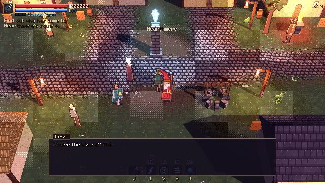 | 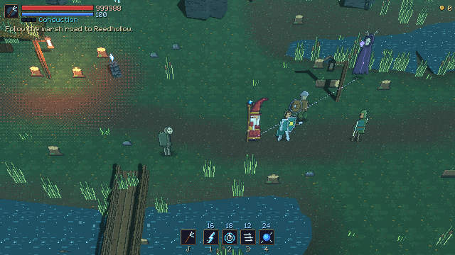 |
| 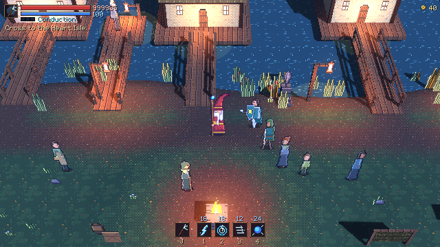 | 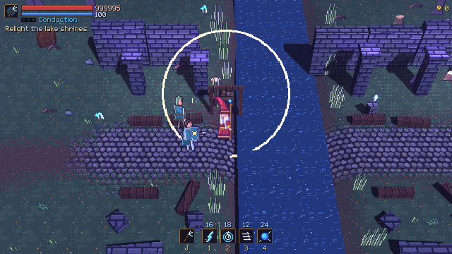 |
| 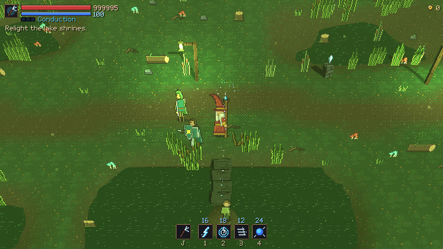 | 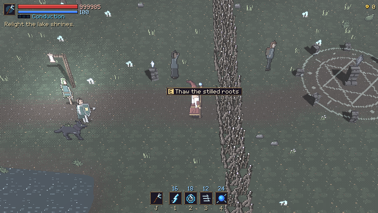 |
| 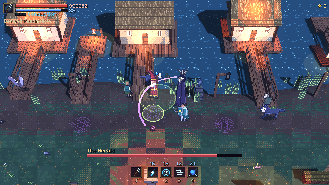 |  |
| 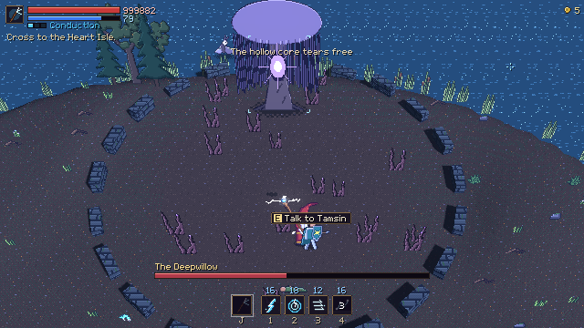 | 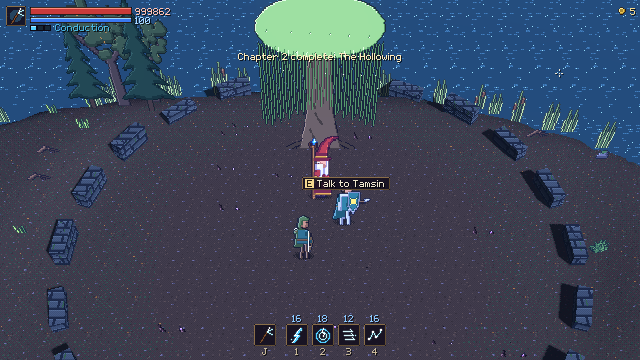 |
| 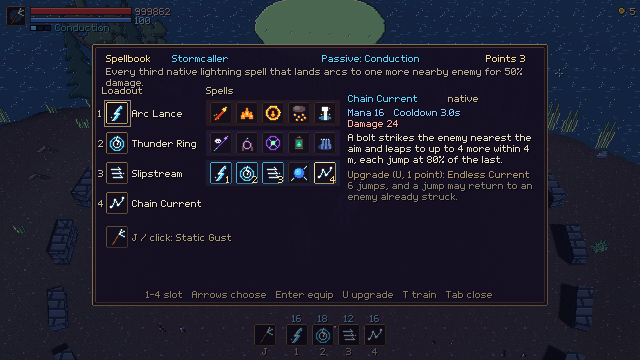 | 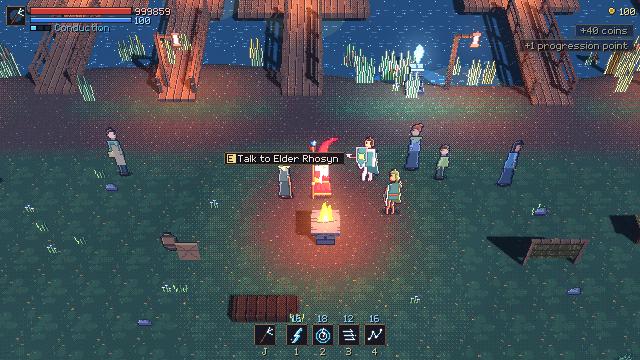 |

## Known limits

- Difficulty and boss health were checked by scripted runs only; the Herald and the Deepwillow
  need a human playtest (numbers in `data/enemies/herald.tres`, `deepwillow.tres`, `deep_knot.tres`).
- Kess's route hints are in her arrival lines; Tamsin–Kess banter beyond those is still thin.
- The Deepwillow's crown is a simple shape; a look pass may want more detail.

