# Wardlight — first playable adventure: evidence report

Godot 4.7.1 (Compatibility renderer), macOS. Everything described here is in the `main` branch
and was checked with automated tests and scripted play captures (`-- --demo=<name>`).

## What's in the build

**Look.** A 3D world seen from a fixed diagonal-down camera (pitch 50°, narrow field of view),
built in code: heightfield terrain with pixel-grid textures and dithered banded lighting, pixel-art
billboard characters (side-facing, 1 px = 1/24 m), real lights from lanterns, braziers and spells.
Trees between the camera and the wizard dither out. The camera frames bosses during fights.

**Combat.** Three schools (Pyromancer, Hexbinder, Stormcaller) with 4 spells each plus upgrades
and a free staff attack; dodge with i-frames and perfect-dodge mana; passives (Heat, Soul Echo,
Conduction); statuses (burn, curse, root); three bounded interactions (Haunted Embers, Grave
Current, Cinderflight). Five enemy roles re-authored for open ground with ring / line / arc
telegraphs drawn over everything. Two bosses:
- **Gatebreaker** (troll in pieces of the broken gate): heavy sweep, ground slam, thrown rubble
  (three at once below half health), long windups and recoveries.
- **The Hollowed Warden** (two phases): sweeping limb, root eruptions, seed burst; transforms at 55%
  without a damage burst; phase 2 changes every pattern.

**Adventure.** Sanctuary → Hearthmere → Briarwood Road (walk-off exits with short fades) → the Old
Ward (waystone journey: animated screen while the destination loads on a background thread, with a
failure fallback). Character setup (name, school, looks). Opening with Pell and a bramble that
teaches the first spell. Dialogue with choices, journal (Q), world map (M), objective line.
Contextual magic: relight the roadside ward (the area lights up and becomes a checkpoint), lift
the fallen trunk, calm the frightened fawn (earns **levitation**: hold Space to hover; crosses the
cliff chasm to a hidden satchel). Checkpoints right before each boss. Isolde's choice (sanctuary
or village, each with a tonic service). After the Warden is cleansed: the ward relights, roots
wither, and Hearthmere is visibly restored (wardlight, lanterns, travellers home, roots gone from
the road, a garland arch, new dialogue). Quest rewards are exactly-once.

**Discoveries and home.** Staffs (each changes the staff attack), robes (a trait each), six relics
with tiers I–III and same-relic fusion at the sanctuary altar (exact preview, atomic, the result
starts unworn). Capped random bonuses. Inventory (I) with comparisons. Enemy XP → progression
points, spent in the spellbook on upgrades (U) and cross-school training (T). Coins, chests,
village gifts, Brannoc's shop after the restoration. Tamsin the shieldbearer: rescued from roots,
then follows, spears enemies she can see, raises a shield wall, gets knocked down and recovers,
never dies, slips back if stuck, waits at the sanctuary when dismissed. Home building (B at the
sanctuary): six placeables unlocked by rewards, grid ghost with reasons for invalid spots, free
moving, refunds on removal.

**Safety of progress.** Versioned save in `user://` written to a temporary file, read back and
validated, previous save kept as a backup; autosaves at checkpoints, quest steps, loot, fusion,
school changes, building and travel. A damaged save is reported (never overwritten) with the
backup offered. New Game asks before replacing a save. Unknown item ids and dangling equipment
are dropped safely on load. Tests use their own save slot.

**Menus and comfort.** Title (continue / new / settings / quit), pause menu, settings with audio
levels, assisted/direct aim, fullscreen, reduce shake, reduce flashes, and full key remapping.
Pause on focus loss.

## Verification

- `tools/dev/check.sh`: every script and resource loads (125 files), **22 rule tests pass**:
  loadouts, affinity, cast refusal costs nothing, cooldowns survive swaps, dodge interrupt keeps
  cost, passives and interactions bounded, exactly-once rewards, forward-only quests, save round
  trip, idempotent restoration, fusion rules and atomicity, equip rules, unknown-id load safety,
  save file validation + backup + damaged-file handling.
- Scripted runs (`godot --path . -- --demo=<name> --shots=<dir>`): `story` plays the whole main
  quest in order and prints the state after every step; `resume --continue` reloads it; `troll`,
  `warden`, `tamsin`, `levitate`, `build`, `inv`, `menus`, `title`, `allspells` capture each system.
- Performance on the M3: 110–120 fps in play (the demo log prints it).
- Exported macOS build (`build/Wardlight.zip`, universal x86_64 + arm64, ad-hoc signed) launched and
  ran the scripted demo at 116 fps.

## Screenshots

| | |
| --- | --- |
| 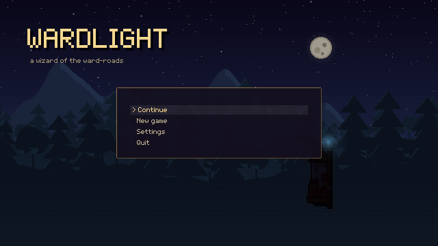 | 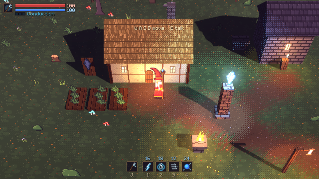 |
| 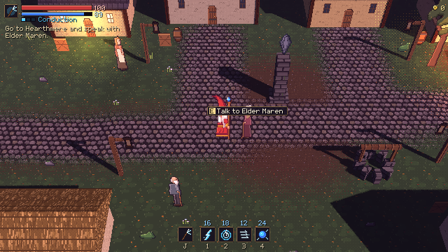 | 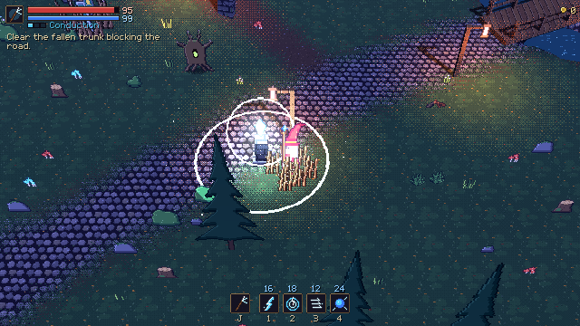 |
| 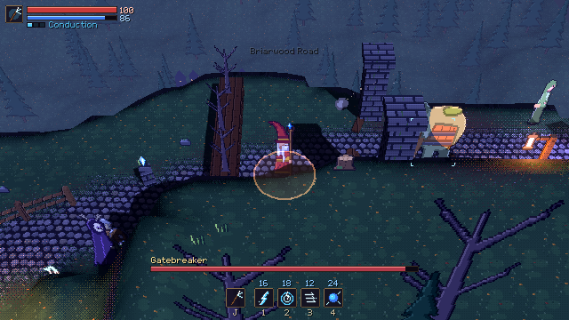 | 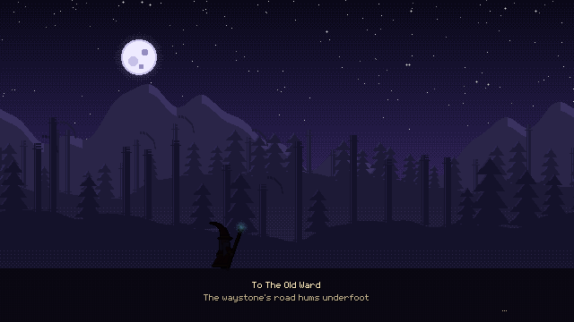 |
| 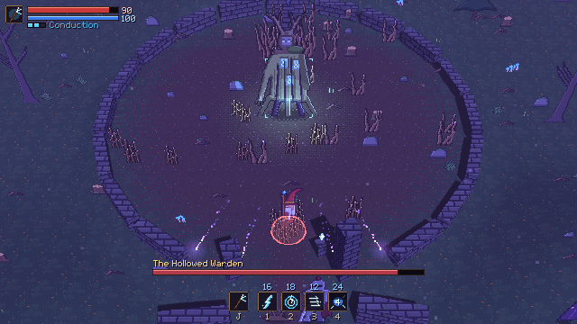 | 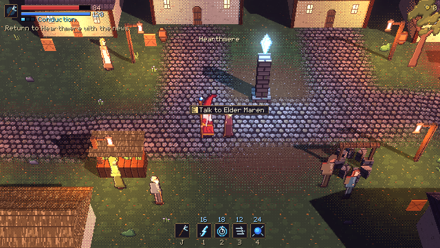 |
| 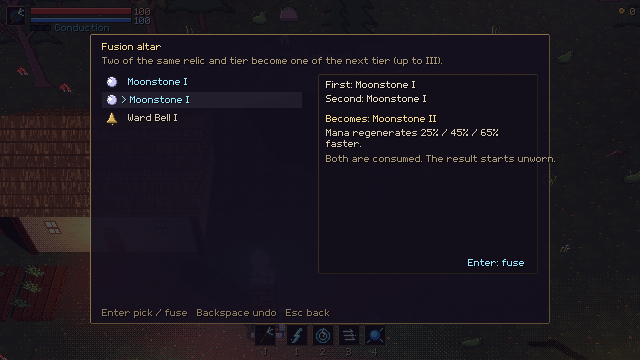 | 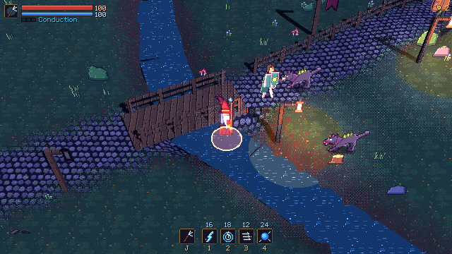 |
| 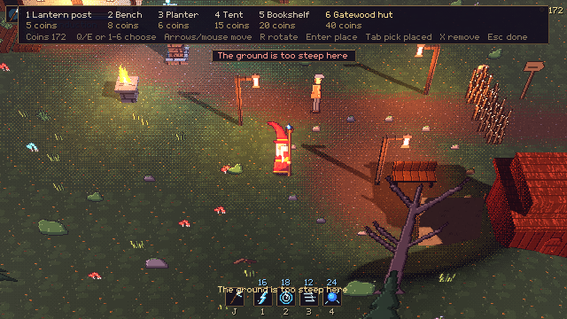 | 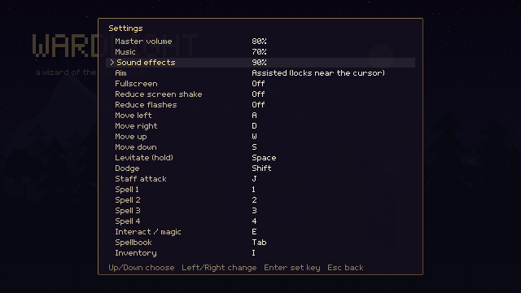 |

## Known limits and next steps

- Difficulty has been checked with scripted runs, not a human hand: the numbers in
  `data/enemies/*.tres` and `data/tuning/player.tres` need a real playtest pass.
- Enemies focus the wizard; Tamsin takes hits only when she stands in an attack.
- The Mac build is ad-hoc signed, not notarised: a copy downloaded from the internet needs
  right-click → Open the first time.
- Regions build their geometry on arrival, so a short hitch can follow the journey screen.
- Agreed cuts from the original brief: cross-relic recipes (same-relic fusion kept); jumping
  (levitation is the traversal ability in the 3D world).
